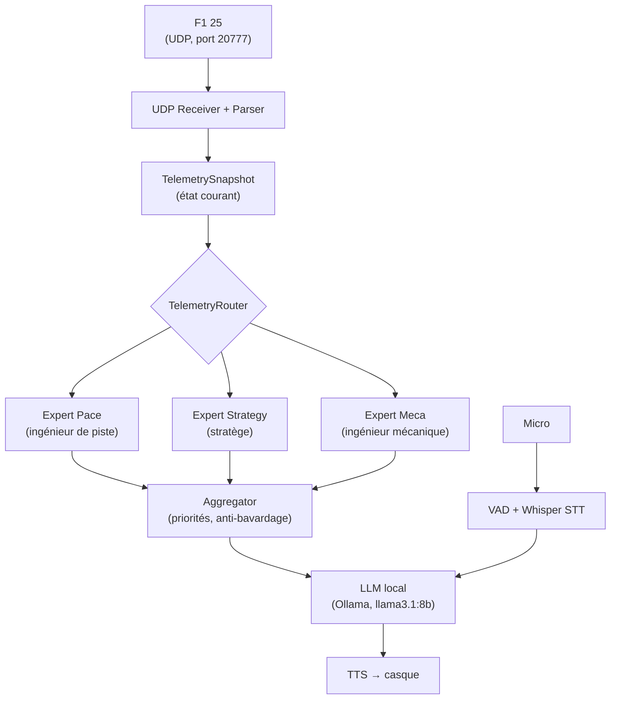

# AI Race Engineer — F1 25

Ingénieur de course IA **temps réel** pour **F1 25** : il lit la télémétrie du jeu, détecte les situations importantes et parle au pilote dans le casque, avec un style radio F1. Le pilote peut aussi lui poser des questions à la voix. Tout tourne **en local**, sans dépendance cloud obligatoire.

> **Statut :** 🚧 en développement — mise en place terminée (Phase 0), Phase 1 (télémétrie UDP) à venir.
> Suivi détaillé : [`JOURNAL_DE_BORD.md`](JOURNAL_DE_BORD.md).

---

## Ce que fera le système

- 📡 **Télémétrie** : lecture en direct des paquets UDP de F1 25 (vitesse, tours, secteurs, pneus, écarts, dégâts…).
- 🧠 **Analyse MoE** : un *router* active un ou plusieurs *experts* spécialisés, comme dans une vraie équipe F1.
- 🗣️ **Voix sortante** : messages radio courts, en anglais (« *You're losing 3 tenths in sector 2.* »).
- 🎙️ **Voix entrante** : questions du pilote (« *How are my tyres?* ») transcrites par Whisper.
- 🤖 **LLM local** : Llama 3.1 8B via Ollama formule les messages à partir de l'état de la course.

## Architecture



### Un MoE *applicatif*

Le projet s'inspire du principe **Mixture of Experts** : spécialiser plusieurs experts et n'activer que ceux qui sont utiles. Mais ce n'est **pas** un MoE neuronal comme Mixtral :

| | MoE neuronal (Mixtral) | MoE applicatif (ce projet) |
|---|---|---|
| Router | Couche de neurones **apprise** | **Règles** et seuils écrits à la main |
| Experts | Sous-réseaux internes au modèle | Modules Python + *system prompt* dédié |
| Granularité | Chaque token, chaque couche | Chaque snapshot de télémétrie |

Les trois experts partagent **un seul LLM** chargé en mémoire, avec un *system prompt* différent pour chacun.

## Stack technique

| Couche | Outil |
|---|---|
| Langage | Python 3.12 (`asyncio`) |
| Télémétrie | `socket` + `struct` (parser écrit sur la spec UDP F1 25) |
| LLM local | Ollama + `llama3.1:8b` |
| Reconnaissance vocale | Whisper `small` (GPU) + `webrtcvad` |
| Synthèse vocale | `pyttsx3` (puis option ElevenLabs) |
| Tests | `pytest` |

Les dépendances sont ajoutées dans `requirements.txt` au fil des phases, quand elles sont réellement utilisées.

## Contraintes matérielles

Développé et testé sur un portable avec **16 Go de RAM** et une **RTX 5060 (8 Go de VRAM)**, sur lequel le jeu tourne en même temps. Budget visé :

| Composant | Mémoire |
|---|---|
| F1 25 | ~4-6 Go |
| Script Python | ~0,5 Go |
| Ollama + LLM 8B (quantifié) | ~6-8 Go |
| Whisper `small` | ~1-2 Go |
| **Total** | **≤ 14 Go** |

C'est ce budget qui exclut les gros modèles, y compris les MoE neuronaux comme Mixtral 8x7B (~26 Go même quantifié).

## Installation (Windows)

Prérequis : Python 3.12, Git. (Ollama, ffmpeg et PyTorch CUDA seront ajoutés dans les phases concernées.)

```powershell
git clone https://github.com/Dsiradiou/AI-Race-Engineer-F1-25.git
cd AI-Race-Engineer-F1-25

py -V:3.12 -m venv .venv
.\.venv\Scripts\Activate.ps1
pip install -r requirements.txt

copy .env.example .env   # puis adapter les valeurs si besoin
```

### Configuration de F1 25

Paramètres du jeu → **Télémétrie** :
- UDP : **On**
- Adresse IP : `127.0.0.1`
- Port : `20777`

### Lancer les tests

```powershell
pytest -v
```

## Structure du projet

```
├── config.py          # paramètres (.env) + seuils de détection
├── telemetry/         # réception UDP, décodage, état de la course
├── analyzer/          # router, experts, agrégateur
├── voice/             # entrée (STT) et sortie (TTS) vocales
├── ai/                # client LLM et system prompts
├── tools/             # enregistrement / rejeu de sessions
├── tests/             # tests pytest (+ fixtures/)
└── logs/              # logs de session (non versionnés)
```

## Documentation du projet

| Fichier | Contenu |
|---|---|
| [`AI_RACE_ENGINEER.md`](AI_RACE_ENGINEER.md) | Document de cadrage complet |
| [`JOURNAL_DE_BORD.md`](JOURNAL_DE_BORD.md) | Étapes du projet et avancement |
| [`RECAPITULATIFS.md`](RECAPITULATIFS.md) | Bilan de chaque étape (tests, mesures, concepts IA) |
| [`QUESTIONS_PEDAGOGIQUES.md`](QUESTIONS_PEDAGOGIQUES.md) | Questions de compréhension sur l'IA, avec corrections |

## Limites connues

- Aucune fonctionnalité utilisable pour l'instant : seules la structure et la configuration existent.
- Ciblé Windows + GPU NVIDIA ; non testé ailleurs.
